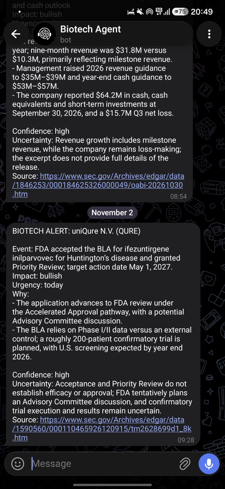
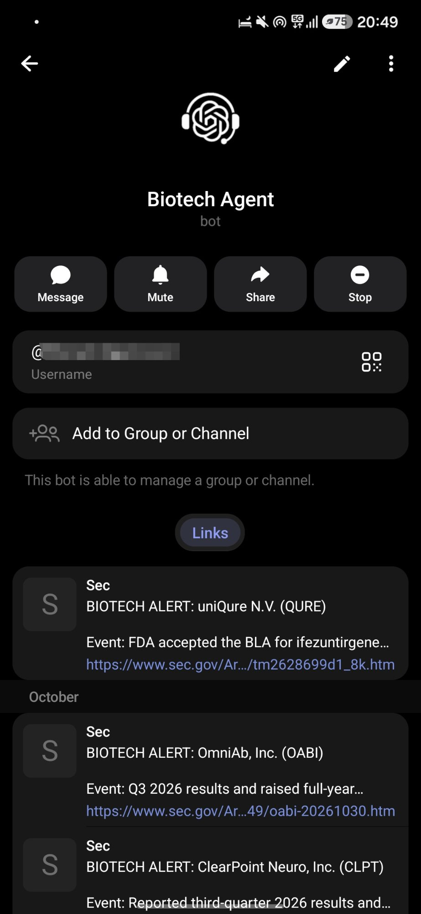

# Company Watch

Watch company news and SEC filings, and get the important updates in Telegram.
It checks RSS feeds, filings, and company news pages, then uses a model to
summarize likely important events. Each alert includes the source link.

This is a personal project. Don't use its output to trade. Read the sources.

<p align="center">
  <a href="docs/images/telegram-alert.jpg"></a>
  <a href="docs/images/telegram-bot-profile.jpg"></a>
</p>

Screenshots from the earlier biotech version, before the name change.

## Setup

You need Python 3.11 or later on Linux. No extra Python packages.

```bash
git clone https://github.com/eldiegoveliz/Company-Watch.git
cd Company-Watch
cp .env.example .env
cp sources.example.json sources.json
cp watched_tickers.example.txt watched_tickers.txt
chmod 600 .env
```

Edit `.env`:

- `TELEGRAM_BOT_TOKEN` and `TELEGRAM_CHAT_ID`: your bot token and chat ID.
- `SEC_USER_AGENT`: your name and contact email.
- `ANALYSIS_PROVIDER`: `codex`, `openai_api`, or `gemini`.

Codex needs a working local login. The API options need their own keys and may
cost money. Choose a model your account can use. See [model setup](docs/analysis.md).
If a coding agent helps you, have it read [AGENTS.md](AGENTS.md) and check your
provider preference.

Check the local settings, then start:

```bash
python3 -m scripts.check_analysis
python3 -m company_watch run
```

Without a Telegram token, alerts print in the terminal.

## Use it

Edit `watched_tickers.txt` to choose companies and `sources.json` to choose feeds.
The examples start with Microsoft SEC filings.

In Telegram:

```text
/status
/watch MSFT Microsoft
/latest
/help
```

`/watch` adds a company, but doesn't add its feeds. See the
[full command and source guide](docs/usage.md).

For clinical trials and FDA news, set `WATCH_PROFILE=biotech` and use the
[biotech examples](docs/profiles.md).

## More

- [Run as a Linux service](docs/deployment.md)
- [Update an older installation](docs/migration.md)
- [Contribute or run the tests](CONTRIBUTING.md)

[GPL-3.0-only](LICENSE).
